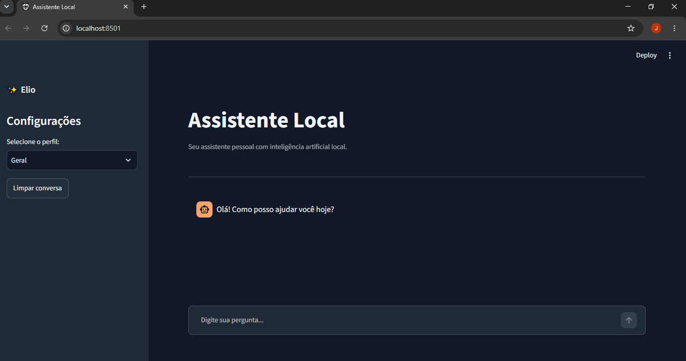
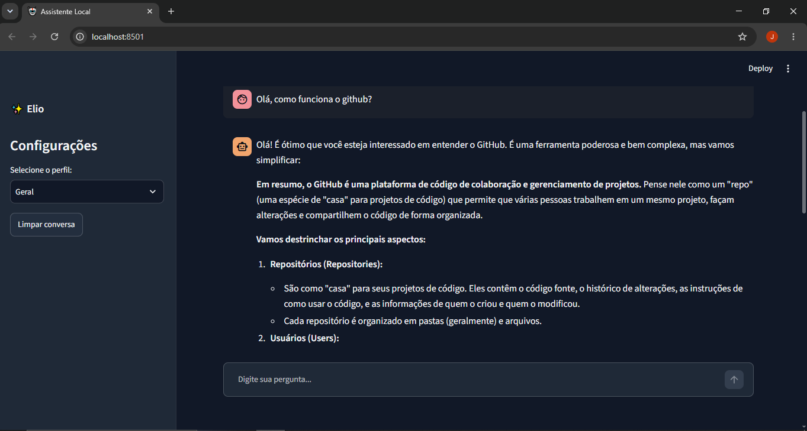
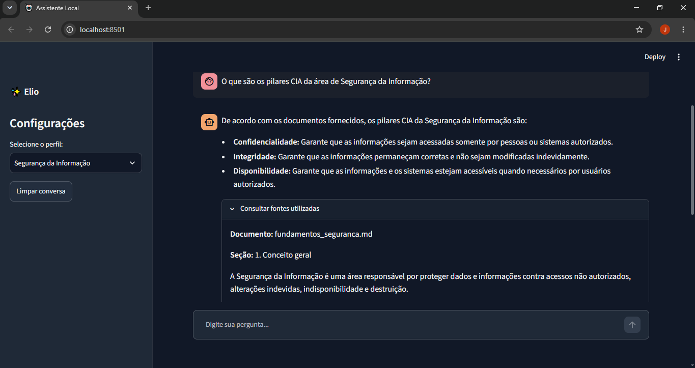

# Elio — Local AI Assistant

[Português](#português) | [English](#english)

---

# Português

## Sobre o projeto

O **Elio** é um assistente de inteligência artificial executado localmente, desenvolvido em Python e integrado ao Ollama e ao Streamlit.

O projeto tem como objetivo explorar a construção de assistentes de IA especializados, combinando modelos de linguagem com uma base de conhecimento própria por meio da técnica RAG (*Retrieval-Augmented Generation*).

A aplicação permite interagir com diferentes perfis de assistência e consultar documentos técnicos, utilizando mecanismos de busca semântica e lexical para recuperar informações relevantes antes da geração das respostas.

O Elio foi desenvolvido como um projeto de aprendizado e experimentação, com foco em inteligência artificial local, recuperação de informações e aplicação prática de conceitos de IA.

## Funcionalidades

- **Assistente com múltiplos perfis:** permite alternar entre três perfis de assistência: Geral, Segurança da Informação e Desenvolvimento de Jogos.
- **Base de conhecimento própria:** permite consultar documentos técnicos em formato Markdown.
- **RAG (Retrieval-Augmented Generation):** recupera informações relevantes dos documentos para fornecer contexto ao modelo durante a geração das respostas.
- **Busca híbrida:** combina busca semântica e lexical para melhorar a recuperação de informações.
- **Organização hierárquica de documentos:** preserva títulos, seções e hierarquia durante o processamento dos conteúdos.
- **Respostas diretas:** utiliza trechos originais da documentação para responder a determinadas perguntas de definição.
- **Histórico de conversas:** mantém as mensagens durante a sessão e permite iniciar uma nova conversa.
- **Identificação das fontes:** apresenta os documentos e trechos utilizados como referência nas respostas.
- **Interface gráfica:** desenvolvida com Streamlit, com tema escuro personalizado.

## Tecnologias utilizadas

| Tecnologia | Aplicação no projeto |
|---|---|
| Python | Linguagem principal utilizada no desenvolvimento. |
| Ollama | Execução local dos modelos de inteligência artificial. |
| Gemma 3 (1B) | Modelo de linguagem utilizado para gerar respostas. |
| Nomic Embed Text | Modelo utilizado para gerar embeddings dos documentos e das perguntas. |
| Streamlit | Desenvolvimento da interface gráfica. |
| Requests | Comunicação com a API local do Ollama. |
| RAG | Técnica utilizada para recuperar informações da base de conhecimento e fornecer contexto ao modelo. |
| Markdown | Formato utilizado para armazenar os documentos da base de conhecimento. |

## Como funciona

O Elio utiliza uma arquitetura baseada em RAG (*Retrieval-Augmented Generation*) para consultar documentos e fornecer informações relevantes ao modelo de linguagem.

O funcionamento pode ser dividido nas seguintes etapas:

1. **Leitura dos documentos:** a aplicação localiza e carrega os arquivos Markdown armazenados na pasta `Documentos`.

2. **Processamento e divisão do conteúdo:** os documentos são organizados em seções, preservando a hierarquia dos títulos. Em seguida, seus conteúdos são divididos em pequenos trechos (*chunks*).

3. **Geração de embeddings:** cada trecho é convertido em uma representação vetorial pelo modelo Nomic Embed Text, permitindo realizar buscas semânticas.

4. **Recuperação de informações:** quando o usuário envia uma pergunta, o sistema gera um embedding da consulta e combina a busca semântica com a busca lexical, utilizando uma pontuação híbrida para identificar os trechos mais relevantes.

5. **Expansão do contexto:** quando aplicável, o sistema recupera informações relacionadas à hierarquia dos documentos, preservando o contexto dos trechos selecionados.

6. **Geração da resposta:** os trechos recuperados são enviados como contexto ao modelo Gemma 3 (1B), executado localmente pelo Ollama, que utiliza essas informações para elaborar a resposta.

Para determinadas perguntas de definição, o sistema também pode retornar diretamente o conteúdo encontrado na documentação, sem solicitar uma nova geração ao modelo.

## Estrutura do projeto

```text
elio-local-ai-assistant/
│
├── .streamlit/
│   └── config.toml
│
├── Documentos/
│   └── fundamentos_seguranca.md
│
├── Documentos_Projeto/
│   ├── ESCOPO_PROJETO_V1.md
│   ├── PROJECT_SCOPE_V1.md
│   ├── GLOSSARIO.md
│   └── GLOSSARY.md
│
├── images/
│   ├── Conversation.png
│   ├── Interface_InitialScreen.png
│   └── Using_RAG.png
│
├── app.py
├── base_conhecimento.py
├── busca.py
├── busca_lexical.py
├── config.py
├── documentos.py
├── embeddings.py
├── ollama.py
├── perfis.py
├── respostas.py
│
├── .gitignore
├── requirements.txt
└── README.md
```

### Principais módulos

| Arquivo | Responsabilidade |
|---|---|
| `app.py` | Interface gráfica e fluxo principal da aplicação. |
| `base_conhecimento.py` | Construção da base de conhecimento e geração

## Requisitos

Antes de executar o Elio, é necessário ter os seguintes componentes instalados:

- **Python 3.10 ou superior**
- **Ollama** instalado e em execução.
- **Gemma 3 (1B)** disponível no Ollama.
- **Nomic Embed Text** disponível no Ollama.

Os modelos podem ser baixados pelo terminal:

```bash
ollama pull gemma3:1b
ollama pull nomic-embed-text
```

A aplicação utiliza a API local do Ollama para comunicação com os modelos.

## Instalação e execução

### 1. Clonar o repositório

```bash
git clone https://github.com/JuninhoPereira95/elio-local-ai-assistant.git
```

Entre na pasta do projeto:

```bash
cd elio-local-ai-assistant
```

### 2. Criar o ambiente virtual

```bash
python -m venv .venv
```

### 3. Ativar o ambiente virtual

No Windows (CMD):

```bash
.venv\Scripts\activate.bat
```

### 4. Instalar as dependências

```bash
pip install -r requirements.txt
```

### 5. Baixar os modelos

```bash
ollama pull gemma3:1b
ollama pull nomic-embed-text
```

Certifique-se de que o Ollama esteja em execução.

### 6. Iniciar a aplicação

```bash
streamlit run app.py
```

Após a inicialização, o Streamlit disponibilizará o endereço local da interface no navegador.

## Capturas de tela

### Interface inicial

Apresentação da interface principal do Elio, incluindo a seleção de perfil e os elementos de navegação.



### Conversação

Exemplo de interação com o assistente e apresentação de uma resposta.



### Utilização do RAG

Exemplo de consulta à base de conhecimento, com recuperação e apresentação das fontes utilizadas na resposta.



## Limitações conhecidas

- **Recuperação de documentos em inglês:** embora o modelo Gemma 3 consiga compreender e responder em inglês, o mecanismo de recuperação de informações ainda está otimizado para documentos em português. Perguntas em inglês podem não recuperar os trechos corretos da base de conhecimento.
- **Base de conhecimento limitada:** a recuperação de informações depende dos documentos disponibilizados na pasta `Documentos`.
- **Modelo de linguagem:** a qualidade e a precisão das respostas dependem das capacidades e limitações do modelo utilizado.
- **Execução local:** o desempenho depende dos recursos de hardware disponíveis, especialmente memória RAM e capacidade de processamento.

## Melhorias futuras

- Aprimorar a recuperação de informações em documentos e perguntas em inglês.
- Expandir a base de conhecimento com novos documentos técnicos.
- Implementar persistência do histórico de conversas.
- Melhorar os mecanismos de recuperação e classificação de relevância dos trechos.
- Explorar novas possibilidades de personalização dos perfis e da interface.
- Avaliar melhorias de desempenho e otimização do processamento local.

## Apoio durante o desenvolvimento

O projeto foi desenvolvido como parte de um processo de aprendizado prático sobre inteligência artificial local, Python e técnicas de recuperação de informações.

Durante o desenvolvimento, o ChatGPT foi utilizado como ferramenta de apoio técnico para esclarecer conceitos, explorar soluções, auxiliar na identificação de problemas e orientar a implementação de funcionalidades.

As decisões de desenvolvimento, integrações, testes e validações foram realizadas ao longo do processo de construção do projeto.


---

# English

## About the Project

**Elio** is a locally running AI assistant developed in Python and integrated with Ollama and Streamlit.

The project aims to explore the development of specialized AI assistants by combining language models with a custom knowledge base using the RAG (*Retrieval-Augmented Generation*) technique.

The application allows users to interact with different assistant profiles and query technical documents. It uses semantic and lexical search mechanisms to retrieve relevant information before generating responses.

Elio was developed as a learning and experimentation project, focusing on local artificial intelligence, information retrieval, and the practical application of AI concepts.

## Features

- **Multiple assistant profiles:** switch between three profiles: General, Information Security, and Game Development.
- **Custom knowledge base:** query technical documents stored in Markdown format.
- **RAG (Retrieval-Augmented Generation):** retrieves relevant information from documents to provide context to the language model when generating responses.
- **Hybrid search:** combines semantic and lexical search to improve information retrieval.
- **Hierarchical document organization:** preserves headings, sections, and document hierarchy during content processing.
- **Direct answers:** uses original documentation excerpts to answer certain definition questions.
- **Conversation history:** keeps messages during the session and allows users to start a new conversation.
- **Source identification:** displays the documents and excerpts used as references in responses.
- **Graphical interface:** built with Streamlit and a customized dark theme.

## Technologies

| Technology | Purpose |
|---|---|
| Python | Main programming language. |
| Ollama | Local execution of AI models. |
| Gemma 3 (1B) | Language model used to generate responses. |
| Nomic Embed Text | Model used to generate document and query embeddings. |
| Streamlit | Graphical user interface. |
| Requests | Communication with the local Ollama API. |
| RAG | Technique used to retrieve information from the knowledge base and provide context to the model. |
| Markdown | Format used to store knowledge base documents. |

## How It Works

Elio uses a RAG-based architecture (*Retrieval-Augmented Generation*) to query documents and provide relevant information to the language model.

The process can be divided into the following steps:

1. **Document loading:** the application locates and loads Markdown files stored in the `Documentos` directory.

2. **Content processing and chunking:** documents are organized into sections while preserving heading hierarchy. Their content is then divided into smaller text segments (*chunks*).

3. **Embedding generation:** each segment is converted into a vector representation using the Nomic Embed Text model, enabling semantic search.

4. **Information retrieval:** when a user submits a question, the system generates an embedding for the query and combines semantic search with lexical search, using a hybrid score to identify the most relevant segments.

5. **Context expansion:** when applicable, the system retrieves information related to the document hierarchy, preserving the context of the selected segments.

6. **Response generation:** the retrieved segments are sent as context to the Gemma 3 (1B) model, running locally through Ollama, which uses this information to generate a response.

For certain definition questions, the system can also return the original content found in the documentation directly, without requesting a new response from the language model.

## Project Structure

```text
elio-local-ai-assistant/
│
├── .streamlit/
│   └── config.toml
│
├── Documentos/
│   └── fundamentos_seguranca.md
│
├── Documentos_Projeto/
│   ├── ESCOPO_PROJETO_V1.md
│   ├── PROJECT_SCOPE_V1.md
│   ├── GLOSSARIO.md
│   └── GLOSSARY.md
│
├── images/
│   ├── Conversation.png
│   ├── Interface_InitialScreen.png
│   └── Using_RAG.png
│
├── app.py
├── base_conhecimento.py
├── busca.py
├── busca_lexical.py
├── config.py
├── documentos.py
├── embeddings.py
├── ollama.py
├── perfis.py
├── respostas.py
│
├── .gitignore
├── requirements.txt
└── README.md
```

### Main Modules

| File | Purpose |
|---|---|
| `app.py` | Graphical interface and main application workflow. |
| `base_conhecimento.py` | Knowledge base construction and embedding generation. |
| `busca.py` | Semantic and hybrid search, and hierarchical context expansion. |
| `busca_lexical.py` | Word extraction and lexical relevance calculation. |
| `config.py` | Model configurations and local API endpoints. |
| `documentos.py` | Document loading, processing, and chunking. |
| `embeddings.py` | Communication with the embedding model. |
| `ollama.py` | Communication with the language model. |
| `perfis.py` | Assistant profiles and their instructions. |
| `respostas.py` | Definition question detection and direct answer retrieval. |

## Requirements

Before running Elio, make sure the following components are installed:

- **Python 3.10 or higher**
- **Ollama** installed and running.
- **Gemma 3 (1B)** available in Ollama.
- **Nomic Embed Text** available in Ollama.

The models can be downloaded from the terminal:

```bash
ollama pull gemma3:1b
ollama pull nomic-embed-text
```

The application uses the local Ollama API to communicate with the models.

## Installation and Execution

### 1. Clone the repository

```bash
git clone https://github.com/JuninhoPereira95/elio-local-ai-assistant.git
```

Navigate to the project directory:

```bash
cd elio-local-ai-assistant
```

### 2. Create a virtual environment

```bash
python -m venv .venv
```

### 3. Activate the virtual environment

On Windows (CMD):

```bash
.venv\Scripts\activate.bat
```

### 4. Install dependencies

```bash
pip install -r requirements.txt
```

### 5. Download the models

```bash
ollama pull gemma3:1b
ollama pull nomic-embed-text
```

Make sure Ollama is running.

### 6. Run the application

```bash
streamlit run app.py
```

After startup, Streamlit will provide a local URL to access the application through your browser.

## Screenshots

### Initial Interface

Overview of Elio's main interface, including profile selection and navigation elements.


### Conversation

Example of an interaction with the assistant and its generated response.


### RAG Usage

Example of a query to the knowledge base, showing information retrieval and the sources used in the response.


## Known Limitations

- **English document retrieval:** although the Gemma 3 model can understand and respond in English, the information retrieval mechanism is currently optimized for Portuguese documents. English queries may fail to retrieve the correct knowledge base segments.
- **Limited knowledge base:** information retrieval depends on the documents available in the `Documentos` directory.
- **Language model:** response quality and accuracy depend on the capabilities and limitations of the selected model.
- **Local execution:** performance depends on the available hardware resources, especially RAM and processing capacity.

## Future Improvements

- Improve information retrieval for English queries and documents.
- Expand the knowledge base with additional technical documents.
- Implement persistent conversation history.
- Improve retrieval and relevance-ranking mechanisms.
- Explore further customization of assistant profiles and the interface.
- Evaluate performance improvements and local processing optimizations.

## Development Assistance

This project was developed as part of a practical learning process focused on local artificial intelligence, Python, and information retrieval techniques.

During development, ChatGPT was used as a technical support tool to clarify concepts, explore solutions, assist with troubleshooting, and guide the implementation of features.

Development decisions, integrations, testing, and validation were carried out throughout the project-building process.